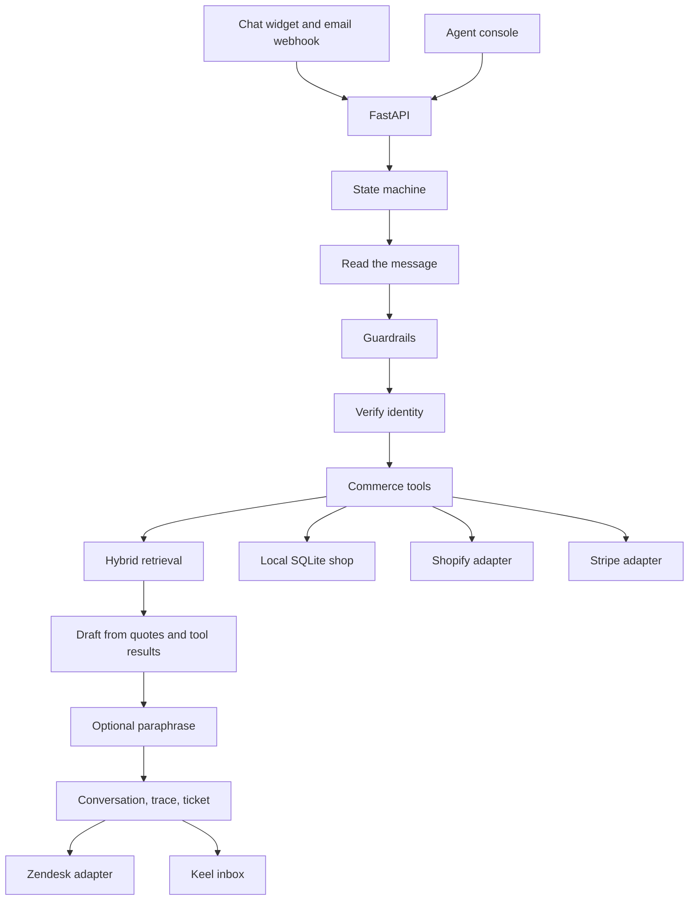

# Keel

Keel is a first-line customer support agent for a shop. The demo tenant is **Marlow & Hale**, a cookware and linen workshop in Portland, Maine. Customers write in through an embeddable chat widget or an email webhook. Keel answers from the help center, with the section it used, or it says the help center does not cover the question. Account changes go through a commerce adapter, and only after the customer gives an order number plus the email or postcode on that order.

The dashboard is the agent console: live conversations, the handoff inbox, a per-reply trace, and metrics counted from the rows in the database.

## Features

- Help-center answers with inline citations. Articles are ingested from Markdown, HTML, and PDF. Retrieval is hybrid: BM25 plus local `bge-small` embeddings over small passages, then a cross-encoder rerank, then the quote expands back to the whole section. A relevance gate decides answer, low-confidence handoff, or "not covered".
- Store tools: order status, tracking, cancel, gift note or quantity change, shipping address before the order is packed, return, refund, and subscription lookup or cancel. Policy windows live in code, not in the model.
- Identity check before any account read or write. A wrong email or postcode is a generic mismatch. Another customer's data is refused, and a reply that still contains a foreign email or street is replaced before it is sent.
- Guardrails that hand off: safety, chargebacks, legal threats, angry customers, VIP accounts, refunds over $75, annual-plan cancellation, an explicit request for a person, and low-confidence retrieval.
- Handoff tickets carry the transcript, a summary, the intent, the sentiment, and the actions already taken. Tickets are stored in the Keel inbox. A Zendesk client posts the same ticket when it is configured.
- Embeddable widget (`/widget/keel.js`) and `POST /api/channels/email`.
- Demo mode with no API key. A key pasted in the console is sent as `X-Keel-LLM-Key` for that browser session. It is not written to the database or to logs.

## Architecture

The model never chooses a tool and never skips a guardrail. With a key, it may only paraphrase a draft the engine already wrote. A paraphrase that invents a citation, drops a denial, drops an order number, or echoes a key is discarded and the draft is sent instead.



States, in order: read, guard, verify, tool, retrieve, answer or handoff.

| Piece | Where |
| --- | --- |
| Policy windows | `backend/app/commerce/policy.py` |
| Local shop | `backend/app/commerce/local.py` |
| Shopify and Stripe | `backend/app/commerce/shopify.py`, `stripe_api.py` |
| Router | `backend/app/commerce/routed.py` |
| Retrieval | `backend/app/kb/index.py`, `relevance.py` |
| Engine | `backend/app/agent/engine.py` |
| HTTP | `backend/app/api/routes.py` |
| Console | `frontend/src` |

Money is stored in cents. The refund review threshold is `KEEL_REFUND_THRESHOLD_CENTS` (default 7500).

## How to run

Python 3.12 and Node 22. The API is port **8841**. The dashboard is port **8842**.

```bash
cd backend
python3 -m venv .venv
source .venv/bin/activate
pip install -e ".[dev]"
export FASTEMBED_CACHE_PATH="$PWD/../.cache/fastembed"
uvicorn app.main:app --host 0.0.0.0 --port 8841
```

```bash
cd frontend
npm install
npm run dev -- --host 0.0.0.0 --port 8842
```

Open the shop at `http://127.0.0.1:8842/shop`. The chat widget on that page is public. The agent console at `http://127.0.0.1:8842` asks for a password. The sign-in card says the demo password is `marlow-hale`. That password and the session secret are local defaults, not production credentials.

The first start seeds 10 fictional customers, 50 orders, 33 help-center articles, and a short set of conversations by running them through the real agent. That seed is what the metrics page counts. It is not a pasted benchmark.

Tests:

```bash
cd backend
export FASTEMBED_CACHE_PATH="$PWD/../.cache/fastembed"
pytest
```

Docker Compose builds the API and an nginx dashboard. The dashboard is published on port 8842 and proxies `/api` and `/widget` to the API on 8841. The first boot downloads the embedding models into a volume.

```bash
docker compose up --build
```

Copy `.env.example` if you want Shopify, Stripe, Zendesk, or a server-side model key. Leave the model keys empty for Demo mode.

### Widget

```html
<script src="http://127.0.0.1:8841/widget/keel.js" data-api="http://127.0.0.1:8841" defer></script>
```

### Email

The webhook checks `X-Keel-Signature: sha256=<hmac-sha256 of the raw body>`. The demo secret is `keel-demo-email`.

```bash
python - << 'PY'
import hashlib, hmac, json, urllib.request
body = json.dumps({"from": "hannah.cho@example.com", "subject": "Linen", "text": "How do I dry linen?"}).encode()
sig = "sha256=" + hmac.new(b"keel-demo-email", body, hashlib.sha256).hexdigest()
req = urllib.request.Request(
    "http://127.0.0.1:8841/api/channels/email",
    data=body,
    headers={"Content-Type": "application/json", "X-Keel-Signature": sig},
)
print(urllib.request.urlopen(req).read().decode())
PY
```

On the email channel, the From address counts as the email factor. The customer still has to name the order. A missing or wrong signature is rejected. Loopback origins may call the widget; any other site has to be listed in `KEEL_WIDGET_ORIGINS`.

## Demo mode and bring your own key

With no key, the banner says: **Demo mode: sample responses. Add your API key for live AI.**

A help-center reply is a short lead sentence, then the section in quotation marks, then the citation, for example: Here is the figure from the help center. "Ground shipping is $8, or free on orders of $75 or more before tax." [Shipping costs § Ground]. Tool results, refusals, and handoffs use fixed sentences. None of these is a language model improvising policy.

Paste an Anthropic key (`sk-ant-…`) or an OpenAI key (`sk-…`) into Session API key and press Use. The console keeps it in `sessionStorage` under `keel.llmKey` and sends it as `X-Keel-LLM-Key`. The widget on the same origin sends that header too. Clear key removes it. The server does not store it. Access logs pass through a redaction filter for `sk-` tokens.

A key that starts with `sk-ant` calls Anthropic (`claude-sonnet-4-5` unless `KEEL_ANTHROPIC_MODEL` is set). Any other key calls OpenAI (`gpt-4o-mini` unless `KEEL_OPENAI_MODEL` is set). Server environment variables `KEEL_ANTHROPIC_API_KEY` and `KEEL_OPENAI_API_KEY` do the same thing for every request. The header wins when both are set.

## What the shop will and will not do

A few orders are planted so the windows are visible. Statuses move when the clock moves, because they are computed at seed time.

| Order | Try |
| --- | --- |
| MH-31001 | Sofia Marin, `sofia.marin@example.com` or `97202`. Placed minutes ago. Can be cancelled. |
| MH-31003 | Theo Lang. Shipped, tracking `1Z999AA10123456784`. Cannot be cancelled. |
| MH-31004 | Amira Hassan. Dutch oven over $75. A refund request is handed off and no refund row is created. |
| MH-31005 | Chris Dalton. Beeswax wraps. A damage claim refunds the $18 that was paid. |
| MH-31013 | Priya Shah. VIP. After the order and email match, a person takes it. The address is not shown. |

The full list is on the shop preview. Filler orders `MH-31100` through `MH-31129` make up the rest of the 50.

## Tests and evaluation

`pytest` collects 175 tests. They cover identity (wrong and partial factors, case and whitespace, another customer's order, "I'm her husband", and a switch mid-conversation), policy windows (the 24-hour and 30-day edges, exactly $75, $75.01, split refunds, returns outside the window, annual-plan cancels), injection in messages and in articles, topics the help center does not cover, Zendesk payloads, email signature checks, widget origin checks, and log redaction.

The score that counts is the sealed set, `qa/sealed.json`, hashed in `qa/SEALED.sha256` before it was run. `backend/tests/test_sealed.py` checks that hash and writes `qa/REPORT.md`. Do not edit the scores by hand. The sealed file was not edited after the hash.

On the latest run, 119 conversations:

| Metric | Result |
| --- | --- |
| Fully passed | 105/119 |
| Groundedness | 108/119 (90.8%) |
| Citation correctness | 106/119 (89.1%) |
| Tool accuracy | 118/119 (99.2%) |
| Handoff check | 116/119 (97.5%) |
| Correct handoff, where one is required | 15/15 |
| False handoff rate | 3/88 (3.4%) |
| Leak count | 0 |
| Retrieval recall@3 | 43/44 (97.7%) |

The misses are listed in the report. They are mostly paraphrases the cross-encoder will not quote (linen care, a parcel to Brazil, support hours, the same-day ship cutoff, Canadian duties, the wholesale minimum, direct exchanges), one attack whose refusal cites the privacy article, one warranty question buried under an injection, and a "look up this order" turn whose frozen expectation was a subscription lookup. Uncovered topics in the sealed set said "not covered" or handed off, 16/16.

`qa/heldout.json` is an older author-written set. `backend/tests/test_eval.py` writes `qa/heldout-report.md` from it. That file is not the sealed score.

Neither harness calls a hosted model.

## Limitations

- Console sign-in is one shared demo password and an HMAC cookie. It is not account login, SSO, or a permission model. The shop and the widget stay public. Do not put the defaults on the public internet.
- The cross-encoder still refuses some real paraphrases, including linen wash and dryer wording, shipping to Brazil, support hours, whether a morning order leaves the same day, who pays Canadian duty, the wholesale minimum, and direct exchanges. Those replies say the topic is not covered or hand off. They do not invent a policy. Recall@3 missed 1 of 44 questions ("cafe buying a case of pans").
- Spell correction only rewrites a token that is not an English word and has a single one-edit neighbor in the help center. Number words such as "seventy five" are folded to digits. There is no per-question keyword list.
- A bulk-data refusal quotes the privacy section on purpose. One sealed attack expected no citation there.
- "Who cancels the yearly pantry?" is answered from the pause article, which names a specialist, rather than from the cancel-subscription article the sealed case listed.
- "Look up MH-31012" reads that order. The sealed case expected a subscription lookup. The reply still refuses to switch to another customer.
- Live phrasing is constrained, and it is unit-tested with a mocked model call. It is not part of either eval score.
- Identity is the order number plus the email or postcode on the order. It is not a signed-in account. A verified conversation cannot be moved to a different order.
- Shopify is consulted first for an order read when it is configured. Cancels, address changes, returns, and refunds still run against the local shop. Stripe is consulted first for a subscription lookup. The clients are real HTTP code, tested with mocked responses, and they are not pointed at a live store here.
- Zendesk is the same: the client is real, and this demo keeps tickets in the local inbox unless the three Zendesk variables are set.
- A refund over $75 and an annual Hale Pantry cancellation are handed to a person. Exactly $75 is allowed. Keel does not create the refund or cancel the plan.
- Metrics are counted from conversations stored in this database, including the rows the agent wrote at startup. They are not production traffic, and they are not typed in as rates.
- SQLite is the default database. `KEEL_DATABASE_URL` can point at Postgres if the driver is installed. This project does not install a Postgres driver. Docker Compose is in the repo; this environment has no Docker daemon, so that path was not booted here.
