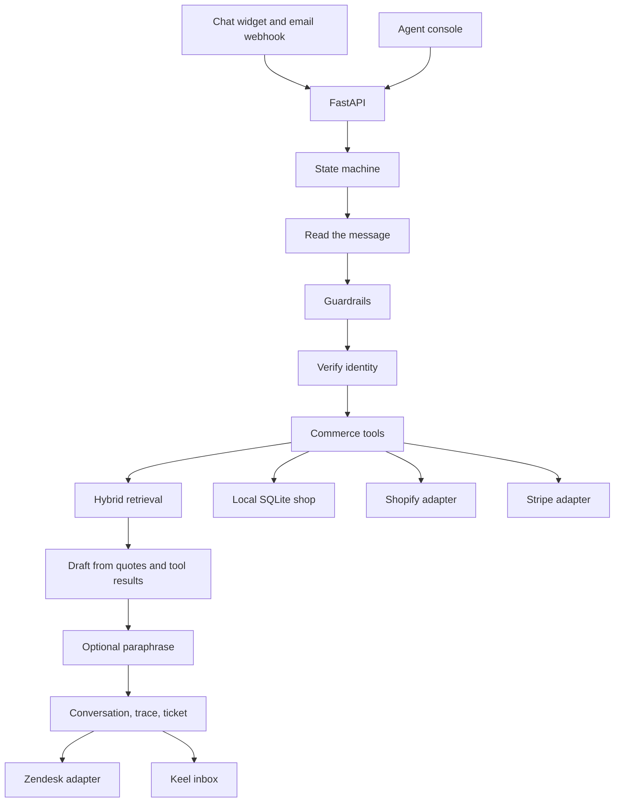

# Keel

Keel is a first-line customer support agent for a shop. The demo tenant is **Marlow & Hale**, a cookware and linen workshop in Portland, Maine. Customers write in through an embeddable chat widget or an email webhook. Keel answers from the help center, with the section it used, or it says the help center does not cover the question. Account changes go through a commerce adapter, and only after the customer gives an order number plus the email or postcode on that order.

The dashboard is the agent console: live conversations, the handoff inbox, a per-reply trace, and metrics counted from the rows in the database.

## Features

- Help-center answers with inline citations. Articles are ingested from Markdown, HTML, and PDF. Retrieval is BM25 plus local `bge-small` embeddings, then a cross-encoder rerank. A relevance gate decides answer, low-confidence handoff, or "I don't know".
- Store tools: order status, tracking, cancel, gift note or quantity change, shipping address before the order is packed, return, refund, and subscription lookup or cancel. Policy windows live in code, not in the model.
- Identity check before any account read or write. A wrong email or postcode is a generic mismatch. Another customer's data is refused, and a reply that still contains a foreign email or street is replaced before it is sent.
- Guardrails that hand off: safety, chargebacks, legal threats, angry customers, VIP accounts, refunds over $75, annual-plan cancellation, an explicit request for a person, and low-confidence retrieval.
- Handoff tickets carry the transcript, a summary, the intent, the sentiment, and the actions already taken. Tickets are stored in the Keel inbox. A Zendesk client posts the same ticket when it is configured.
- Embeddable widget (`/widget/keel.js`) and `POST /api/channels/email`.
- Demo mode with no API key. A key pasted in the console is sent as `X-Keel-LLM-Key` for that browser session. It is not written to the database or to logs.

## Architecture

The model never chooses a tool and never skips a guardrail. With a key, it may only paraphrase a draft the engine already wrote. A paraphrase that invents a citation, drops a denial, drops an order number, or echoes a key is discarded and the draft is sent instead.



States, in order: read, guard, verify, tool, retrieve, answer or handoff.

| Piece | Where |
| --- | --- |
| Policy windows | `backend/app/commerce/policy.py` |
| Local shop | `backend/app/commerce/local.py` |
| Shopify and Stripe | `backend/app/commerce/shopify.py`, `stripe_api.py` |
| Router | `backend/app/commerce/routed.py` |
| Retrieval | `backend/app/kb/index.py`, `relevance.py` |
| Engine | `backend/app/agent/engine.py` |
| HTTP | `backend/app/api/routes.py` |
| Console | `frontend/src` |

Money is stored in cents. The refund review threshold is `KEEL_REFUND_THRESHOLD_CENTS` (default 7500).

## How to run

Python 3.12 and Node 22. The API is port **8841**. The dashboard is port **8842**.

```bash
cd backend
python3 -m venv .venv
source .venv/bin/activate
pip install -e ".[dev]"
export FASTEMBED_CACHE_PATH="$PWD/../.cache/fastembed"
uvicorn app.main:app --host 0.0.0.0 --port 8841
```

```bash
cd frontend
npm install
npm run dev -- --host 0.0.0.0 --port 8842
```

Open the console at `http://127.0.0.1:8842`. The shop preview, with the widget, is `http://127.0.0.1:8842/shop`.

The first start seeds 10 fictional customers, 50 orders, 33 help-center articles, and a short set of conversations by running them through the real agent. That seed is what the metrics page counts. It is not a pasted benchmark.

Tests:

```bash
cd backend
export FASTEMBED_CACHE_PATH="$PWD/../.cache/fastembed"
pytest
```

Docker Compose builds the API and an nginx dashboard. The dashboard is published on port 8842 and proxies `/api` and `/widget` to the API on 8841. The first boot downloads the embedding models into a volume.

```bash
docker compose up --build
```

Copy `.env.example` if you want Shopify, Stripe, Zendesk, or a server-side model key. Leave the model keys empty for Demo mode.

### Widget

```html
<script src="http://127.0.0.1:8841/widget/keel.js" data-api="http://127.0.0.1:8841" defer></script>
```

### Email

```bash
curl -s http://127.0.0.1:8841/api/channels/email \
  -H 'content-type: application/json' \
  -d '{"from":"hannah.cho@example.com","subject":"Linen","text":"How do I dry linen?"}'
```

On the email channel, the From address counts as the email factor. The customer still has to name the order.

## Demo mode and bring your own key

With no key, the banner says: **Demo mode: sample responses. Add your API key for live AI.**

Replies in that mode are sentences copied from the retrieved section, or a fixed sentence for a tool result, a refusal, or a handoff. They are not a language model improvising policy.

Paste an Anthropic key (`sk-ant-…`) or an OpenAI key (`sk-…`) into Session API key and press Use. The console keeps it in `sessionStorage` under `keel.llmKey` and sends it as `X-Keel-LLM-Key`. The widget on the same origin sends that header too. Clear key removes it. The server does not store it. Access logs pass through a redaction filter for `sk-` tokens.

A key that starts with `sk-ant` calls Anthropic (`claude-sonnet-4-5` unless `KEEL_ANTHROPIC_MODEL` is set). Any other key calls OpenAI (`gpt-4o-mini` unless `KEEL_OPENAI_MODEL` is set). Server environment variables `KEEL_ANTHROPIC_API_KEY` and `KEEL_OPENAI_API_KEY` do the same thing for every request. The header wins when both are set.

## What the shop will and will not do

A few orders are planted so the windows are visible. Statuses move when the clock moves, because they are computed at seed time.

| Order | Try |
| --- | --- |
| MH-31001 | Sofia Marin, `sofia.marin@example.com` or `97202`. Placed minutes ago. Can be cancelled. |
| MH-31003 | Theo Lang. Shipped, tracking `1Z999AA10123456784`. Cannot be cancelled. |
| MH-31004 | Amira Hassan. Dutch oven over $75. A refund request is handed off and no refund row is created. |
| MH-31005 | Chris Dalton. Beeswax wraps. A damage claim refunds the $18 that was paid. |
| MH-31013 | Priya Shah. VIP. After the order and email match, a person takes it. The address is not shown. |

The full list is on the shop preview. Filler orders `MH-31100` through `MH-31129` make up the rest of the 50.

## Tests and evaluation

`pytest` covers policy windows, the Shopify, Stripe, and Zendesk clients against mocked HTTP, Markdown/HTML/PDF ingest, and an adversarial set: injection in the message and in a poisoned article, cross-customer requests, refunds over the threshold and over the amount paid, the 24-hour and 30-day edges, and identity spoofing across turns.

The held-out harness is `qa/heldout.json`. `backend/tests/test_eval.py` writes `qa/REPORT.md` from that run. Do not edit the scores by hand. The current report is 36 of 36 cases, with groundedness, citation correctness, tool-call accuracy, and handoff correctness all at 36/36, and a leak count of 0. The poisoned article did not get its instruction into the reply.

Those prompts were written for this product. They are not an independent customer sample, and they do not measure a hosted model's phrasing. See the report for the exact definitions.

## Limitations

- The console has no login. It is a local demo of one shop. Do not put it on the public internet as-is.
- Demo replies quote the help center. They can be blunt, and they can cite more than one section when several sentences match.
- Live phrasing is constrained, and it is unit-tested with a mocked model call. It is not part of the held-out score.
- Identity is the order number plus the email or postcode on the order. It is not a signed-in account.
- Shopify is consulted first for an order read when it is configured, and that order is then the one Keel describes. Cancels, address changes, returns, and refunds in this build still run against the local shop. Stripe is consulted first for a subscription lookup. The clients are real HTTP code, tested with mocked responses, and they are not pointed at a live store here.
- Zendesk is the same: the client is real, and this demo keeps tickets in the local inbox unless the three Zendesk variables are set.
- A refund over $75 and an annual Hale Pantry cancellation are handed to a person. Keel does not create the refund or cancel the plan.
- The retrieval gate can hand off when a question only partly matches an article. Uncovered questions are supposed to be a don't-know, not a guess. The gate is a heuristic.
- Metrics include the seeded conversations. Those rows were produced by the agent at startup. They are not production traffic, and they are not typed in as rates.
- SQLite is the default database. `KEEL_DATABASE_URL` can point at Postgres if the driver is installed. This project does not install a Postgres driver.
